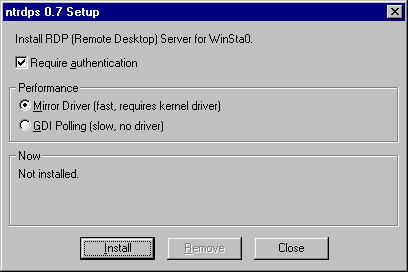

# NTRDPS

A Remote Desktop (RDP) Server for Windows NT 3.1, 3.5, 3.51 and 4.0, pre-TSE Hydra and pre-WinFrame. RDP client connects to `WinSta0`, or the local console. No WTS, no MultiWin.

Yes you can Remote Desktop to NT 3.1...

## Install

Download the installer for your CPU from [Releases](https://github.com/tenox7/ntrdps/releases), run it and click Install.

**Require authentication:** the RDP client has to log on with a user name and password.

- NT 3.51 and 4.0: a Windows account in the Administrators group.
- NT 3.1 and 3.5: they can't check Windows passwords, so Setup asks for a user name and password just for ntrdps.

If you turn it off, anyone who can reach TCP port 3389 gets the console.

From a script, without the window:

    ntrdpset /install /q
    ntrdpset /remove /q
    ntrdpset /status /q

Options for `/install`: `/poll` for GDI Polling, `/nologin` for no authentication, `/user:NAME /password:PW` for the NT 3.1 / 3.5 user name and password.

## Performance

Setup installs a driver by default: the Mirror Driver on NT 4.0, the Layered Driver on NT 3.x. It is fast and works after a restart. GDI Polling needs no driver and no restart, but it is slow.

If the Layered Driver can't work with your video card, ntrdps uses GDI Polling. The Now box in Setup shows which one runs.

Compression settings, in `HKLM\SOFTWARE\ntrdps` (REG_DWORD). Restart the ntrdps service after a change.

| Value | Default | What it does |
|---|---|---|
| `Compression` | 1 | 0 turns compression off: less CPU use on the NT machine, more network traffic |
| `CompressionMaxType` | 1 | 1 = RDP 5.0 compression (64 KB history), 0 = RDP 4.0 compression (8 KB) |

## History and prior art

While services and background processes on Windows NT could always assume role / run as specific user, the Windows desktop was single user and the local console only.

Applications like Symantec pcANYWHERE, Dameware Mini Remote Control or VNC allowed remotely controlling the local desktop by use of a mirror driver or GDI polling.

Citrix licensed source code of Windows to develop MultiWin feature. In September 1995 they shipped a product called WinFrame, which introduced concept of WinStation and remote connectivity with ICA protocol.

Around 1998 Microsoft released Windows NT 4.0 Terminal Server Edition (TSE) aka "Hydra". It came with a new protocol named Remote Desktop Protocol (RDP), which unlike ICA, was Microsoft owned. Citrix continued shipping ICA protocol as an TSE addon called Metaframe. Later TSE was renamed to WTS (Windows Terminal Services).

Interestingly RDP protocol was developed at Microsoft out of [NetMeeting](https://en.wikipedia.org/wiki/NetMeeting) and ITU T.120/128. There is [a video](https://www.youtube.com/watch?v=qhay6VryyvE) about it.

NTRDPS is based on the same protocol from NetMeeting but connects only to the console like pcANYWHERE/DMRC/VNC.

## FAQ

Q: Which RDP version is supported
A: 4.0 / 5.x

## License

MIT
